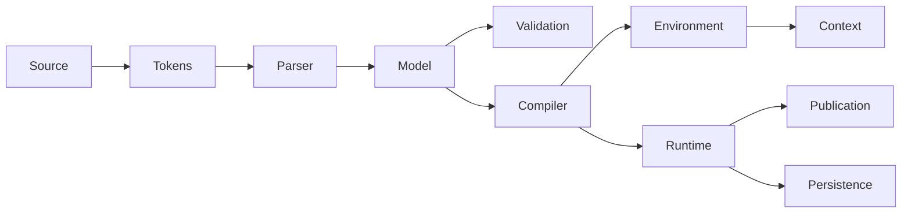

# LXC architecture

Read DESIGN.md for semantics and README.md for use. This document describes the
private implementation contracts so a reader can follow a declaration to a call.
No module publishes its mutable state through package.loaded or the root API.

## Source to instance

Model traverses dependencies with explicit frames rather than recursive protected calls, so it imposes no configured inheritance-depth limit.

Loader owns the transaction: parse all files, resolve/validate the graph, allocate
all new class identities, compile all bodies, initialize statics in dependency
order, recheck destination bindings, then commit/publish. Preparation never runs
application bodies. Instance allocation/construction happens later through a
checked class identity. A failed constructor invalidates its shell. A failed
load invalidates every staged class, including references leaked by a callback.

## File contracts

| File | Entry points and responsibility |
| --- | --- |
| LuaEx/lxc/init.lua | Captures trusted dependencies and loads the 24 production modules relative to itself; returns a decoy API. |
| lxc-prototype/lxc.lua | Forwarding loader to the production entry point. |
| modules/Tokens.lua | scan(source, file): source-preserving tokens with byte offsets, lines and string/number kinds; comments are opaque. |
| modules/Names.lua | valid(name): shared declaration/generated-name policy. |
| modules/Parser.lua | Factory(Tokens, Names). parse(source, file): ordered declarations with outer/owner links; no execution. |
| modules/LuaScope.lua | Factory(Tokens). references(body, file, parameters, expression): Lua variable uses and lexical bindings. |
| modules/Model.lua | Factory(Validation, Diagnostics, Names). Private registry, resolution/access queries and dependency traversal. |
| modules/Validation.lua | Factory(Model, Diagnostics, Names). Class, base, member, property, constructor and collision contracts. |
| modules/Compiler.lua | Factory(Tokens, Model, LuaScope). Compile methods/initializers and extract first-statement parent calls. |
| modules/Environment.lua | Factory(Model, Context, Facades). Create registered class scopes and checked read-only namespace views. |
| modules/Context.lua | Factory(). Register lexical environments/internal frames and determine the actual using scope. |
| modules/Facades.lua | State-wide opaque identity creation and dispatch. Shares dispatch across independent runtime registries. |
| modules/Runtime.lua | Factory of injected services. Owns identities, typed slots, dispatch, construction and static initialization. |
| modules/Helpers.lua | Factory(Model, Context, Runtime, Facades). Opaque scope-restricted metadata/reference helpers. |
| modules/Diagnostics.lua | format(definition, error), run(definition, operation, ...): innermost source/declaration context. |
| modules/Literal.lua | Factory(Tokens). Restricted data-only wire encoder/parser, independent of object restoration. |
| modules/SnapshotSchema.lua | validate(graph): complete structural validation before restored shells are allocated. |
| modules/GraphAccess.lua | Factory(Model). validate(graph, caller, definitions): storage and exposed-reference authority, including forged/aliased graph paths. |
| modules/Persistence.lua | Factory(Model, Context, Runtime, Literal, Schema, GraphAccess). Graph identity, instance/static snapshots and cloning. |
| modules/Loader.lua | Composition, source/file/discovery entry points, batch staging and publication; returns only the opaque API. |
| modules/Host.lua | Binds normal LuaEx clone/serialize/type entry points and framework aliases; recognizes tagged class saves. |
| modules/HostGraph.lua | Reads older version-two host envelopes with validated capture reconnection. |
| modules/HostStaged.lua | Projects typed class state into the existing serializer's additive staged graph protocol; validates scope before allocation, fills slots after foreign restoration, invalidates shells on failure. |

`LuaEx/load.lua` binds Host after core services, retains level 0 core-only behavior,
loads baseline primitives at level 2, filters bundled classes by requested group,
and merges recursive application discovery into one dependency-ordered batch.
Framework require paths return the loaded LXC identities through package.loaded.
HostStaged/HostGraph are private composition, not replacement global serializers. Standalone
codec calls retain restricted data-only parsing; host saves execute trusted code.
`LuaEx/lib/serializer.lua` retains ordinary version-one graphs and adds explicit
serializeStaged/deserializeStaged transactions for version-two staged graphs.
Staged node state edges do not impose eager factory dependencies: LXC shells
exist before arrays/other existing factories validate their items. Existing
foreign eager cycles remain rejected. Function encoding/upvalue joining is shared.

Factories make dependencies explicit and keep separate LXC loads' registries
independent. Only Facades shares the Lua state's decoy dispatch infrastructure.

## Private records

| Record | Relevant fields and invariants |
| --- | --- |
| Token | Text, Start, Stop, Line, optional Kind. Positions refer to original source; strings/comments are not rewritten internally. |
| Class | FullName, Namespace, Outer, Parent, Flags, Visibility, File/Line, Imports, Members, ByName, Nested. Members preserve source order. |
| Validated class | AbstractMembers, Aliases, PrivateNames. PrivateNames includes all ancestral private names, protecting lexical lookup on optimized public paths. |
| Staged class | Batch, Object, State, Static, Compiled, Initialized, Published/Discarded. Discarded identities cannot be used. |
| Member | Owner, Name, Kind, Flags, Visibility, source metadata, Parameters/Variadic, Body/Initializer, compiled functions. |
| Property | Accessors, original Slot, optional Overrides. Overrides share Slot and preserve accessor contract/names. |
| Instance state | Object, Class, Values, cached Methods/BaseViews/StorageViews/LexicalViews, Constructing, Failed. Never exposed. |
| Slot | Member, Value, Type, Locked, optional initialization State. A class Type is its original internal base-class constraint. |

Class/instance registries are weak-key private maps. Definition records are not
class identities. A plain table supplied by application code cannot impersonate
a registered identity or mutate its storage through rawget/rawset.

## Access and dispatch

References are empty Lua table decoys. Their shared protected metatable delegates
operations to a private weak-key handler map. Raw entries can shadow decoy lookup;
hidden storage remains separate. See DESIGN.md for concrete raw-write behavior.
The public metatable label exposes no handler or state. Bootstrap reuses Facades
through `debug.getregistry()['LXC.Facades.TableDecoys']`, under the agreed debug
exception. Private Facades.owns checks keep existing decoys out of host-table
snapshot enumeration on subsequent loads. Foreign thread metatables are untouched.
Each Context registers the same trusted dispatch frames, preserving mixed-runtime
operand lookup and external callback boundaries without sharing class registries.

Equality uses binary dispatch with identity fallback when neither operand declares
__eq. Lua controls native type eligibility and same-table identity short-circuiting.
Internal record comparisons concern private ordinary records; facade identity
checks use rawequal and registry-key lookup. Graph traversal recognizes registered
objects/classes before treating tables as ordinary data.

Instances declaring __gc retain the private finalizable handler sidecar. Decoys
do not also install native __gc, avoiding duplicate hooks. Finalization restores
the weak dispatch and object entries for private reads/resurrection. Ready/failed
state checks suppress hooks on incomplete or discarded instances; Lua finalizes
each sidecar once, including after resurrection.

Compiled scopes are associated with declaring classes in Context. The first
non-runtime Lua caller establishes rights; external functions stop the search.
Compiler-retained _ENV upvalues let legitimate nested closures retain ownership.
There is no global current-class variable or push/pop privilege stack to leak
across errors or yields.

The `local __lxc_guard <close> = nil;` declarations are intentional Lua 5.4 frame
retention. They prevent internal/compiled tail calls from erasing a relevant
boundary. Context rejects privilege inference across an external tail call.
The nil value runs no close handler. Do not remove these as unused variables
without replacing the protection and passing the callback/tail-call regressions.

Compiler rewrites qualified expression roots to a private lexical view. Bare
references passed/returned remain ordinary identities. Field is rewritten only
when it refers to the accessor backing binding, never when it is a table key or
selector. LuaScope distinguishes locals, parameters, loops, nested functions and
other syntax before resolving class references or diagnosing ambiguous imports.
Direct _ENV access and __lxc-prefixed source identifiers are rejected.

Public instance operations skip stack inspection only when no same-name private
member exists anywhere in their ancestry. Restricted access and private-name
reuse still resolve under the real using scope. Method signature compatibility
is checked at load time; calls perform no automatic argument/return type checking.

## Persistence boundaries

Snapshots contain Version, Root and flat Nodes. Value descriptors hold a primitive,
null marker or graph reference. Instance fields use declaring-class-qualified
keys, type constraints and binding-lock flags. This preserves aliases, table keys,
cycles and distinct private declarations. Restored shells become reachable by
the caller only after complete schema/type/field validation. Constructors do not run.

Literal accepts only data syntax, at most 16 MiB and fewer than 256 literal nesting
levels; SnapshotSchema accepts at most 100,000 graph nodes. It rejects executable
expressions, duplicate entries and invalid references. String decoding invokes Lua
only on an isolated already-tokenized string literal in an empty environment.
Unsupported application values produce explicit errors rather than lossy saves.

The root codec is explicit host authority: instance snapshots contain private
state. It is not automatically placed in class environments. Class-reference
operations remain visibility checked. Immutable locks and statically known literal/constructor contracts
are validated; dynamic initialization state is restored from validated per-slot
snapshot data, without executing application initializers or claiming authenticity.
GraphAccess checks class references under storage-owner or authorized using-scope rights; publicly readable storage also preserves recipient visibility. It rejects transplanting hidden factories into unrelated or exposed slots. Static restoration validates its entire mutation plan before changing storage.

## Tests and maintenance

Tests are separated by purpose: contracts, context/intrusion, loading, persistence,
language operations and cross-module acceptance. test.lua also runs examples and
independent-runtime isolation checks. integration.lua uses real LuaEx core discovery
in a fresh state. benchmark.lua measures public/compiled hot paths independently.
Run.ps1 supplies a fresh native Lua 5.4 state without loading wxLua or opening a GUI.

Keep semantics in DESIGN.md, contributor constraints in RULES.md, vocabulary in
KEYWORDS.md and public usage/results in README.md. Obsolete checkpoint reports and
duplicate checkpoint runners have been removed; maintained tests are the evidence.
